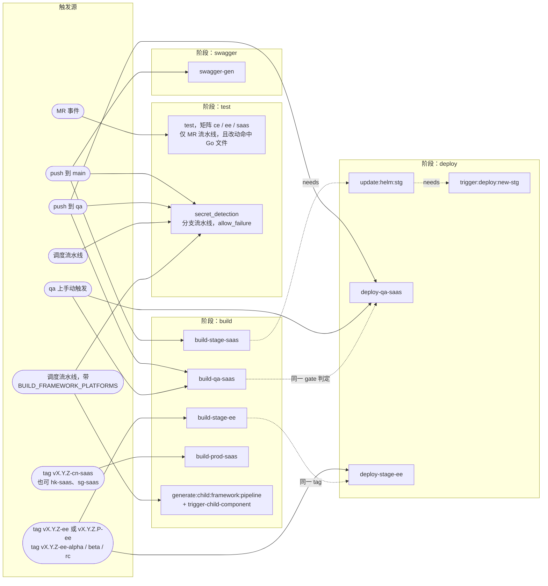
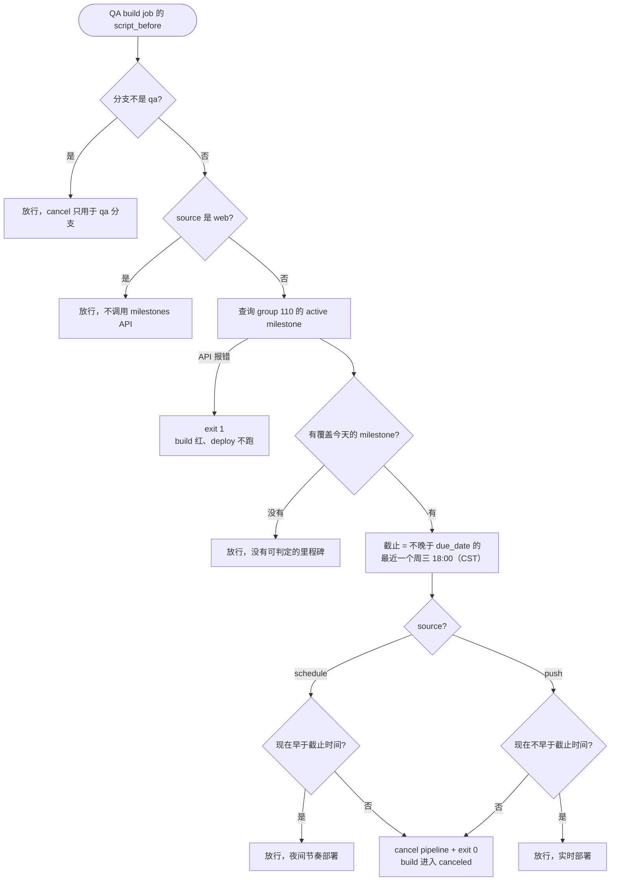
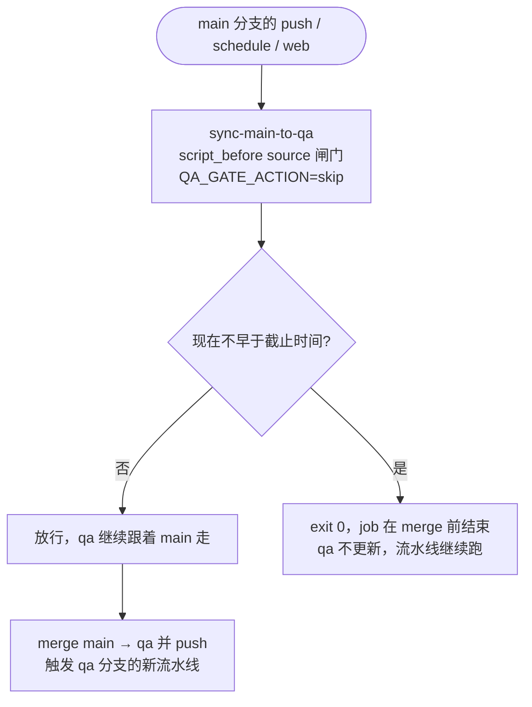
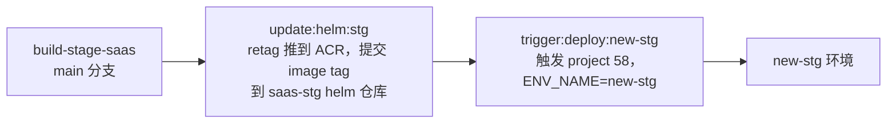

# CI 流水线

`.gitlab-ci.yml` 里放公共的 component include（`secret-detection`、`test`、`swagger`）、
stage 列表和公共变量，然后引入下面所有 `.gitlab/ci/*.yml`。stage 按顺序执行，同一个 stage
内的 job 并行。

```
test  ->  sync  ->  swagger  ->  build  ->  deploy
```

## 分支与 tag

### 分支

| 分支 | 触发方式 | 创建的 job |
|---|---|---|
| `main`（默认分支，`$CI_DEFAULT_BRANCH`） | push、web | `secret_detection`、`sync-main-to-qa`、`swagger-gen`、`build-stage-saas`、`update:helm:stg`、`trigger:deploy:new-stg`（另有 `deploy-stg-saas`：main push 上 `when: manual`，临时跑老部署脚本，见「SaaS stg / prd 部署」） |
| `main` | schedule | `secret_detection`、`sync-main-to-qa` |
| `qa` | push、web | `secret_detection`、`build-qa-saas`、`deploy-qa-saas` |
| `qa` | schedule | `secret_detection`、`build-qa-saas`、`deploy-qa-saas` |
| 其他分支 | push、web | `secret_detection` |
| 其他分支 | schedule | `secret_detection` |
| 任意分支，且带 `BUILD_FRAMEWORK_PLATFORMS` | schedule | `secret_detection`、`generate:child:framework:pipeline`、`trigger-child-component` |
| 任意分支 | MR 事件 | `test`（`ce` / `ee` / `saas` 三份，且 diff 命中 `**/*.go`、`*.mod`、`*.sum`、`*.sql`） |

`generate:child:framework:pipeline` 和 `trigger-child-component` 只出现在最后那种调度里，也就是
那 6 个 framework 调度（`vllm`、`sglang`、`llama.cpp`、`llama.cpp-cpu`、`llama-factory`、
`vllm-cuda118`）。QA 调度不带 `BUILD_FRAMEWORK_PLATFORMS`，所以不会创建它们——否则 QA 调度会
顺带跑一次 framework 子流水线，而 framework 那三个变量是空的，`generate` 会直接 `exit 1` 变红。

`build-qa-saas` 和 `deploy-qa-saas` 还要过里程碑闸门才会真正执行。`secret_detection` 在任何
有分支的流水线里都会创建，所以它和 `test` 是互补的：分支流水线跑密钥扫描，MR 流水线跑单测。

### tag

| tag 形态 | 示例 | 构建 | 部署 |
|---|---|---|---|
| EE 正式 | `v3.0.0-ee` | `build-stage-ee`，amd64 + arm64 | `deploy-stage-ee` → `stage` 环境 |
| EE 预发布 / 四位版本 | `v3.0.0.1-ee`、`v3.0.0-ee-alpha`、`v3.0.0-ee-beta`、`v3.0.0-ee-rc.2`、`v3.0.0.1-ee-rc` | `build-stage-ee`，amd64 | `deploy-stage-ee` → `stage` 环境 |
| SaaS 生产 | `v3.0.0-cn-saas`、`v3.0.0.1-hk-saas`、`v3.0.0-sg-saas` | `build-prod-saas`，amd64 | `deploy-prd-saas`，**手动触发**（`when: manual`） |
| 其他 | `v3.0.0`、`v3.0.0-cn`、`v3.0.0-ee-xyz`、`v3.0.0-rc-cn-saas` | 无 | 无 |

只有上面这些形态合法，其余 tag 不会创建任何 job。`build-stage-ee` 的两条规则里第一条优先，
所以只有纯 `vX.Y.Z-ee` 构建双架构，四位版本号和 `-alpha` / `-beta` / `-rc` 落到第二条，只
构建 amd64。`v3.0.0-ee-xyz` 一条都不匹配：`-ee` 后面只能是 `alpha` / `beta` / `rc` 加一个
可选序号，或者直接结束。SaaS 生产 tag 不支持预发布后缀，`v3.0.0-rc-cn-saas` 不匹配。

### 推送的镜像

| 构建 job | 镜像 |
|---|---|
| `build-stage-saas` | `$CI_REGISTRY_IMAGE:<short sha>-cn-saas`、`registry.opencsg.com/opencsg_public/starhub-server:<short sha>-cn-saas` |
| `build-qa-saas` | 同 staging，tag 也是 `<short sha>-cn-saas` |
| `build-stage-ee` | `registry.opencsg.com/opencsghq/csghub-server:$CI_COMMIT_TAG`、`docker.io/opencsghq/csghub-server:$CI_COMMIT_TAG` |
| `build-prod-saas` | `$CI_REGISTRY_IMAGE:$CI_COMMIT_TAG`、`registry.opencsg.com/opencsg_public/starhub-server:$CI_COMMIT_TAG` |

### SaaS 的 region 与 `CSGHUB_TAGS`

`<region>` 必须是 `build_saas_version.json` 里的 key（`cn-saas`、`hk-saas`、`sg-saas`）。
构建组件用 `${CI_COMMIT_TAG#*-}` 从 tag 里还原它，再把 `$BUILD_EDITION` 展开成表里存的
flag 列表，所以 `v3.0.0-cn-saas` 实际带的是
`CSGHUB_TAGS=license_issuer,license_federation,saas`。规则对 region 的匹配比这个约束宽，
`v3.0.0-foo-saas` 能通过规则，但会在组件查表时失败。

生产构建跑在 tag 上，`CI_COMMIT_TAG` 有值，直接用。staging 和 QA 跑在分支上，
`CI_COMMIT_TAG` 本来是空的，`${CI_COMMIT_TAG#*-}` 于是也是空串，查表拿到 null，
`null + ["saas"]` 只剩下 `saas`——两个 license flag 会丢。所以这两个 include 在规则里把
`CI_COMMIT_TAG` 覆盖成 `${CI_COMMIT_SHORT_SHA}-cn-saas`。它是 predefined 变量，优先级最低，
`rules:variables` 覆盖得了（只有 `CI_ENVIRONMENT_ID`、`CI_ENVIRONMENT_SLUG`、
`CI_ENVIRONMENT_URL`、`CI_PAGES_URL` 例外）。这样组件能推出 `cn-saas`，而且 `images`、
`--build-arg IMAGE_TAG`、helm 的 `image.tag` / `runner.image.tag` 读的是同一个变量，build
和 deploy 不会错位。GitLab 官方不建议覆盖 predefined 变量，这里是绕不开组件的实现，代价
是 job 日志里的 `Tag:` 会显示这个假 tag。

验证方式是看 build job 日志里组件打的那行，`Tag` 有值且 `Edition` 带上前两个 flag 才算对：

```
==> Edition: license_issuer,license_federation,saas | Tag: <short sha>-cn-saas | Commit: <short sha>
```

## 部署目标

| 触发 | 部署 job | 部署到 | 方式 |
|---|---|---|---|
| `main` 分支 push、web | `update:helm:stg` → `trigger:deploy:new-stg` | `new-stg` 环境 | 先把镜像 retag 推到 ACR，再改 saas-stg helm 仓库里 `update.sh-stg` / `-a800` / `-a100` 的 tag 并提交，最后触发 project 58 的流水线，带 `ENV_NAME=new-stg`、`starhub_tag=<镜像 tag>` |
| `qa` 分支（过闸门） | `deploy-qa-saas` | `qa` 环境 | helm upgrade，kubeconfig 取 File 变量 `KUBECONFIG_SAAS_QA` |
| `-ee` tag | `deploy-stage-ee` | `stage` 环境 | helm upgrade，kubeconfig 取 File 变量 `KUBECONFIG_EE` |
| `-<region>-saas` tag | `deploy-prd-saas` | `prd` 环境 | **手动触发**（`when: manual`，等 `build-prod-saas` 推完镜像后人工点 play）。helm upgrade，kubeconfig 取 File 变量 `KUBECONFIG_SAAS_PRD`，chart 来自 saas-prd 仓库根目录 |
| `main` 分支 push、web | `deploy-stg-saas`（手动 play） | `stg` 环境（`new-stg`） | **临时**：点 play 后跑 `scripts/deploy-stg-legacy.sh` —— clone saas-stg 仓库并 `bash update.sh-stg`，部署逻辑同 starhub-deployment 的 `deploy:new-stg-helm`（kubeconfig 取本项目已有的 File 变量 `KUBECONFIG_SAAS_STG`，`tags: [kubernetes]`），脚本内 `exit 0` 不跑组件 helm。chart 就绪后切回 helm upgrade。详见「SaaS stg / prd 部署」 |

两个 helm 部署用的是同一套默认值：release `csghub`、namespace `csghub`、chart `csghub`
（来自 `https://charts.opencsg.com/csghub`），`image.tag` 和 `runner.image.tag` 被覆盖成新
tag。两个 include 都没传 `chart_values`，所以 helm 走 `--reset-then-reuse-values`，复用该
release 上一次的 values——也就是说 release 必须已经存在，否则部署会失败。

`deploy-stage-ee` 这个名字来自组件的 `deploy-<environment>-<edition>`：`.gitlab-ee-stage.yml` 的
deploy include 传的是 `environment: stage` + `edition: ee`，和 `build-stage-ee` 对齐。副作用
是 GitLab 的 `environment:` 关键字也跟着变成 `stage`，所以这次 EE 部署会记在 `stage` 环境
下，而不是 `ee` 环境——如果之前给 `ee` 环境配过 protected environment 或审批规则，那些不会
生效。

## 文件

| 文件 | 内容 |
|---|---|
| `.gitlab/ci/.gitlab-ee-stage.yml` | EE 镜像构建（tag 触发）与 EE helm 部署 |
| `.gitlab/ci/.gitlab-saas-stage.yml` | SaaS staging 镜像构建（main） |
| `.gitlab/ci/.gitlab-saas-prod.yml` | SaaS 生产镜像构建（tag 触发） |
| `.gitlab/ci/.gitlab-saas-qa.yml` | QA 镜像构建与 helm 部署（qa 分支，带里程碑闸门） |
| `.gitlab/ci/.deploy-ci.yml` | staging 部署链路：`update:helm:stg`（GitOps）后接 `trigger:deploy:new-stg` |
| `.gitlab/ci/.build-framework-ci.yml` | 调度流水线里通过生成的子流水线构建 runtime framework |
| `.gitlab/ci/.build-ci.yml` | 子流水线实例化用的 `.build` 模板 |
| `.gitlab/ci/scripts/qa-release-gate.sh` | QA 里程碑闸门，被 `build-qa-saas` 和 `sync-main-to-qa` 两个 job source；`QA_GATE_ACTION=cancel`（默认，build job）命中 skip 时调 pipeline cancel API，`QA_GATE_ACTION=skip`（sync job）只结束自己的 job、不动流水线 |
| `.gitlab/ci/scripts/update-helm-stg.sh` | `update:helm:stg` 的 `update_helm_stg_setup` / `update_helm_stg_run`：镜像 retag 推到 ACR、改 saas-stg 仓库的 `update.sh-*` 并提交 |
| `.gitlab/ci/scripts/deploy-saas-chart.sh` | `deploy-stg-saas` / `deploy-prd-saas` 的 custom_script：clone chart 仓库到本地（`saas_chart_vars` 里的变量做非空校验，目前为空列表） |
| `.gitlab/ci/scripts/deploy-stg-legacy.sh` | **临时**：`deploy-stg-saas` 过渡期的部署步骤（clone saas-stg 仓库 + `bash update.sh-stg`），跑完 `exit 0` 不执行组件 helm；chart 就绪后删除 |

job 名由组件决定：`build-<environment>-<edition>`、`deploy-<environment>-<edition>`，
另外还有 `swagger-gen`、`test`、`secret_detection`。

## 总览



## Job 说明

下面每个 job 都列出创建它的那条 rule。没列出来的 job 一律不跑。

### `secret_detection` — stage `test`

GitLab 的 `Jobs/Secret-Detection.gitlab-ci.yml`，带 `allow_failure: true`。

```yaml
- if: $SECRET_DETECTION_DISABLED == 'true' || $SECRET_DETECTION_DISABLED == '1'
  when: never
- if: $AST_ENABLE_MR_PIPELINES == "true" && $CI_PIPELINE_SOURCE == "merge_request_event"
- if: $AST_ENABLE_MR_PIPELINES == "true" && $CI_OPEN_MERGE_REQUESTS
  when: never
- if: $CI_COMMIT_BRANCH
```

只要流水线有分支就跑，也就是任意分支的 `push`、`web`、`schedule` 流水线。tag 流水线没有
`CI_COMMIT_BRANCH`，MR 流水线也没有（除非把 `AST_ENABLE_MR_PIPELINES` 打开），所以这两种
都不扫描。

### `test` — stage `test`，矩阵 `ce` / `ee` / `saas`

```yaml
- if: $CI_PIPELINE_SOURCE == "merge_request_event"
  changes: ["**/*.go", "**/*.mod", "**/*.sum", "**/*.sql"]
- when: never
```

只在 MR 流水线跑，且 diff 命中上面那几个路径。三个副本并行，一个 edition 一个，`needs: []`
所以立即启动。`golangci-lint` 默认关闭，除非把 `lint_enabled` 设成 `true`。

### `sync-main-to-qa` — stage `sync`

`sync-branch` 组件生成的 job，rules 用组件默认值 `$CI_COMMIT_BRANCH == $CI_DEFAULT_BRANCH`，
所以 main 分支上的 push、web、schedule 流水线都会创建它。它 source
`.gitlab/ci/scripts/qa-release-gate.sh`（`QA_GATE_ACTION=skip`），按截止时间决定合不合入，
详见「sync main → qa」一节。

### `swagger-gen` — stage `swagger`

```yaml
- if: $CI_PIPELINE_SOURCE != "schedule" && $CI_COMMIT_BRANCH == $CI_DEFAULT_BRANCH
```

main 分支上非调度的流水线。把 `docs/` 作为 artifact 上传。

### `build-stage-saas` — stage `build`

```yaml
- if: $CI_PIPELINE_SOURCE != "schedule" && $CI_COMMIT_BRANCH == $CI_DEFAULT_BRANCH
  variables: { CI_COMMIT_TAG: "${CI_COMMIT_SHORT_SHA}-cn-saas" }
```

main 分支上非调度的流水线。推 `$CI_REGISTRY_IMAGE` 和
`registry.opencsg.com/opencsg_public/starhub-server`，两个都用 `<short sha>-cn-saas` 打 tag。
这里的 `CI_COMMIT_TAG` 是伪造的，见上文「SaaS 的 region 与 `CSGHUB_TAGS`」。

### `build-stage-ee` — stage `build`

```yaml
- if: '$CI_COMMIT_TAG =~ /^v\d+\.\d+\.\d+-ee$/'
  variables: { PLATFORMS: "linux/amd64,linux/arm64" }
- if: '$CI_COMMIT_TAG =~ /^v\d+\.\d+\.\d+(\.\d+)?-ee(-(alpha|beta|rc)(\.\d+)?)?$/'
  variables: { PLATFORMS: "linux/amd64" }
```

第一条规则匹配纯 `vX.Y.Z-ee` 正式 tag 并优先命中，所以只有这种形态构建双架构。
`vX.Y.Z.P-ee` 和任何 `-alpha` / `-beta` / `-rc` tag 落到第二条规则，只构建 amd64。推
`registry.opencsg.com/opencsghq/csghub-server:$CI_COMMIT_TAG` 和
`docker.io/opencsghq/csghub-server:$CI_COMMIT_TAG`，走构建代理。

### `build-prod-saas` — stage `build`

```yaml
- if: '$CI_COMMIT_TAG =~ /^v(\d+\.\d+\.\d+(\.\d+)?)-[a-z]+-saas$/'
```

任意 SaaS region tag，例如 `v3.0.0-cn-saas`、`v3.0.0.1-hk-saas`。推的仓库和 staging 相同，
tag 用 `$CI_COMMIT_TAG`。

### `build-qa-saas` 与 `deploy-qa-saas` — stage `build` 和 `deploy`

```yaml
- if: $CI_COMMIT_BRANCH == "qa" && ($CI_PIPELINE_SOURCE == "schedule" || $CI_PIPELINE_SOURCE == "push" || $CI_PIPELINE_SOURCE == "web")
  variables: { CI_COMMIT_TAG: "${CI_COMMIT_SHORT_SHA}-cn-saas" }
```

两个 job 用的是完全相同的这条规则，但只有 build 真正 source
`.gitlab/ci/scripts/qa-release-gate.sh`：闸门命中 skip 条件时调
`/pipelines/:id/cancel` 把整个流水线取消（pipeline 状态 `canceled`），build 的 script 段
（buildx push）也来不及跑完就被 SIGTERM 杀掉，job 状态是 "canceled"（灰），不发邮件。build
没有 allow_failure（默认 false），所以 build 真失败时是 "failed"（红），发邮件——这是真失败，
发邮件正是想要的；deploy 因为 `when: on_success` + `needs: ["build-qa-saas"]` 不会启动，
也就不用再写一道 gate。deploy 显式声明 `needs: ["build-qa-saas"]`，确保 helm 在 build 推
完镜像之后才启动。

`CI_COMMIT_TAG` 是伪造的，理由见上文「SaaS 的 region 与 `CSGHUB_TAGS`」。build 用
`$CI_COMMIT_TAG` 拼镜像 tag 和 `--build-arg IMAGE_TAG`，deploy 用它填 `image.tag` 和
`runner.image.tag`，两边取到的是同一个值。

闸门自身的判定条件见下文「SaaS QA 里程碑闸门」一节。

### `deploy-stage-ee` — stage `deploy`

```yaml
- if: '$CI_COMMIT_TAG =~ /^v\d+\.\d+\.\d+(\.\d+)?-ee(-(alpha|beta|rc)(\.\d+)?)?$/'
```

所有 `ee` tag 都会部署，正式和预发布都算，所以 `v3.0.0-ee` 和 `v3.0.0-ee-rc.1` 都会部署。
helm 模式，`KUBECONFIG_EE`，把 `image.tag` 和 `runner.image.tag` 设为 `$CI_COMMIT_TAG`。job
名和 GitLab 环境名都由 include 里的 `environment: stage` + `edition: ee` 决定。

### `update:helm:stg` 与 `trigger:deploy:new-stg` — stage `deploy`

```yaml
- if: $CI_PIPELINE_SOURCE != "schedule" && $CI_COMMIT_BRANCH == $CI_DEFAULT_BRANCH
```

`update:helm:stg` needs `build-stage-saas`；`trigger:deploy:new-stg` needs
`update:helm:stg`。见下文「Staging 部署链路」。

### `generate:child:framework:pipeline` 与 `trigger-child-component` — stage `build`

```yaml
- if: $CI_PIPELINE_SOURCE == "schedule" && $BUILD_FRAMEWORK_PLATFORMS
```

任意分支的调度流水线，且带 `BUILD_FRAMEWORK_PLATFORMS`。前一个 job 生成子流水线，为每个
runtime framework 实例化一次 `.gitlab/ci/.build-ci.yml` 里的 `.build`；后一个触发它并等待
结果。两个 job 用同一条规则，所以要么都创建要么都不创建——`trigger-child-component` 的
`needs` 指向另一个，只有一边存在会让流水线直接失败。

`if: $BUILD_FRAMEWORK_PLATFORMS` 这种写法是「变量存在且非空」才为真，未定义和空串都为假，
正好用来区分 framework 调度和其他调度。

## SaaS QA 里程碑闸门

`rules` 在流水线创建时求值，读不到日期，所以 QA 的规则把两种节奏都匹配上，由闸门在运行时
决定。脚本 source 自 `custom_script_position: script_before`（v1.4.8+ 才有，之前是
`before_script`，但 v1.4.7 之前 `custom_script` 跑在 `before_script` 里，bash 的 `exit`
不会阻止 `script` 段接着跑，所以从前闸门其实不生效——这是 v1.4.8 的 `script_before` 选项
才修掉的）。

闸门有两种动作，由 `QA_GATE_ACTION` 决定：

- `cancel`（默认）：命中 skip 条件时调 `/pipelines/:id/cancel` 把整个流水线取消，pipeline 进
  入 `canceled` 状态，build 段（buildx push）来不及跑就被 SIGTERM 杀掉，job 状态是
  "canceled"（灰），不发邮件。build 没有 allow_failure，所以 build 真失败（docker error 等
  非闸门原因）时是 "failed"（红），发邮件——这是真失败，发邮件正是想要的；deploy 因为
  `when: on_success` + `needs` 不会启动。两种情况 deploy 都不会跑，区别只在 pipeline 是
  canceled 还是 failed。cancel 只允许在 `qa` 分支上执行，否则会连 main 流水线一起取消。
- `skip`：`sync-main-to-qa` 用这个。命中 skip 条件时 job 直接 `exit 0`，在 merge 之前结束，
  `qa` 不更新，流水线照常往下跑。判定只看截止时间，详见「sync main → qa」一节。

截止时间是覆盖今天的那个 open milestone 的 due_date 之前（含当天）最近一个周三的
**18:00（CST）**。比较用的是绝对时间戳，不受 runner 时区影响。



所以截止时间之前由调度流水线部署、push 不部署；到点之后 push 部署、调度流水线停止。调度可以
一直开着不用关：下一个里程碑开始时截止时间会自动前移。手动触发永远部署。

闸门需要 `curl`、`jq`，以及 `jq` 的 `strptime`（jq >= 1.6）。组件 v1.4.8 在自己的
`before_script` 装好了 `apk add bash jq gettext curl coreutils`，所以 custom_script 里不用
再装。

读 group 110 的 milestone 用的是 `STARHUB_GROUP_CI_TOKEN`，需要在那个 group 上有 `api`
权限（cancel pipeline 是写操作，`read_api` 不够），用 `PRIVATE-TOKEN` 头。不能用
`$CI_JOB_TOKEN`：job token 不被 group 级接口接受。

变量没配或者 token / API 失效时闸门直接 `exit 1`，job 变红、发邮件——infra 问题应当被暴露，
不能静默放行。cancel 模式下的 `cancel_pipeline` 也一样：cancel 失败（curl 报错、4xx/5xx、
超时）时返回 1，由调用处 `|| exit 1` 让 build 红，否则 build 照跑 + deploy 也跑，时间门的
skip 决定就被静默丢了。

## sync main → qa

`sync-branch` 组件生成的 job，把 `main` 合到 `qa` 再 push 回去。push 用
`STARHUB_GROUP_CI_TOKEN`，所以会触发 `qa` 分支上的新流水线。

它 source 同一个闸门脚本，但用 `QA_GATE_ACTION=skip`：命中 skip 条件时 job 在 merge 之前
`exit 0`，`qa` 不更新，main 流水线也不被 cancel（cancel 只发生在 `QA_GATE_ACTION=cancel` 下，
而且被限制在 `qa` 分支）。



截止时间之前 `qa` 一直跟着 `main` 走，夜间部署能拿到最新代码；从第二周周三 18:00 起一律
skip，push、schedule、web 都不再触发同步，发布候选冻结。`qa` 上的实时部署因此只可能来自
手动 push。

## Staging 部署链路



`update:helm:stg` 改 `update.sh-stg`、`update.sh-a800`、`update.sh-a100` 里的
`--set image.tag=` 并推到 `saas-stg.git`；`trigger:deploy:new-stg` 再带着新 tag 触发下游
部署项目。两个 job 都会读项目变量里的 `STARHUB_DEPLOY_TRIGGER_TOKEN` 和
`NEWSTG_STARHUB_DEPLOY_TRIGGER_TOKEN`。

## 版本（Edition）

| Edition | 本流水线是否构建 | 说明 |
|---|---|---|
| `saas` | 是 | staging 来自 `main`，生产来自 `-<region>-saas` tag，QA 来自 `qa` |
| `ee` | 是 | 来自 `-ee` tag，用 `docker/Dockerfile-ee` |
| `ce` | **否** | 本流水线不构建也不部署 CE。`docker/Dockerfile` 存在但没有任何 job 引用它，`ce` 只出现在 `test` 矩阵里。这不是这次迁移造成的：迁移前的流水线同样没有 CE 构建 job |

edition Dockerfile 依赖的基础镜像（`Dockerfile-base-build`、`Dockerfile-base-runtime`）在
本流水线之外构建。

## SaaS stg / prd 部署

两个 job 都用 deploy 组件做 helm 部署，**只推 starhub-server 的镜像版本和 registry**，
其余参数一律不传：

| job | chart 来源 | chart_set | 触发 |
|---|---|---|---|
| `deploy-stg-saas` | saas-stg 仓库的 `csghub-stg/` | 镜像 tag 3 条 + registry 3 条 | **临时**：main push + 手动 play → 跑 `scripts/deploy-stg-legacy.sh`（clone saas-stg 并 `bash update.sh-stg`），组件 helm 暂不执行 |
| `deploy-prd-saas` | saas-prd 仓库根目录 | 同上 | `-<region>-saas` tag + **手动 play** |

### 为什么只推镜像 tag 和 registry

组件的 `chart_values` 没设置时，helm 走 `--reset-then-reuse-values`：先把 values 重置成 chart
默认值，再把**该 release 上一次的 values 合并回来**。于是：

- CI 只覆盖 `image.tag`、`*.image.registry` 这几个 key，域名、对象存储、外部中间件、各组件
  的非镜像配置全部沿用 release 上当前生效的值；
- 服务器本地改过的参数不会被下一次 CD 冲掉，自由度留在本地；
- 查当前生效的全部参数：`helm get values csghub -n csghub`。

这也是 chart_set 里**不再**照搬 saas-stg / saas-prd 两个仓库 update.sh 那几百条 `--set` 的原因：
那些是环境配置，不是发布物。

chart_set 与 `deploy-qa-saas` 对齐（qa 有 5 条，这里 6 条 —— 多一条 `global.image.tag`）：

```yaml
        - 'image.tag=$CI_COMMIT_TAG'                 # starhub-server
        - 'global.image.tag=$CI_COMMIT_TAG'
        - 'runner.image.tag=$CI_COMMIT_TAG'
        - 'global.image.registry=...'                # registry
        - 'global.imageRegistry=...'
        - 'image.registry=...'
```

⚠️ **registry 的值两边不一样，别互相抄**：

| 环境 | registry | 镜像命名空间 |
|---|---|---|
| qa | `registry.opencsg.com`（Harbor） | `opencsghq` |
| stg / prd | `opencsg-registry.cn-beijing.cr.aliyuncs.com`（ACR） | `opencsg_public` |

`global.image.registry` 是**全局**的，会影响 casdoor / temporal / redis / gitaly / minio 等所有
子组件，改之前先确认目标 registry 里这些镜像都在。

另外 `global.imageRegistry` 这条目前**不生效**：chart 的 `common/templates/_image.tpl` 只读
`localImage.registry`（组件级）和 `global.image.registry`，不读这个 key。保留它只是让三套环境的
chart_set 结构一致；真正决定镜像地址的是 `global.image.registry` 和 `image.registry`。

### 给其他项目复用的镜像模板

`portal` / `xnet` / `csgbot` / `langflow`（即 agenticflow）的镜像由各自项目维护，本项目不推，
但 chart_set 里留了 4 行注释模板：

```yaml
        # - 'portal.image.tag=$PORTAL_IMAGE_TAG'
        # - 'xnet.image.tag=$XNET_IMAGE_TAG'
        # - 'agentichub.agenticflow.image.tag=$AGENTICFLOW_IMAGE_TAG'
        # - 'agentichub.csgbot.image.tag=$CSGBOT_IMAGE_TAG'
```

复制到别的项目时放开即可。⚠️ 放开前必须先在那边配好变量：变量缺失时组件的 `envsubst` 会把它
展开成空串，helm 收到 `--set-string portal.image.tag=` 会**直接把镜像 tag 清空**。放开的同时
把变量名加进 `scripts/deploy-saas-chart.sh` 的 `saas_chart_vars`，缺失时就会 `exit 1`。

### 需要配置的 CI 变量

`deploy-stg-saas`（临时阶段）—— kubeconfig 用本项目已有的 `KUBECONFIG_SAAS_STG`，clone 仓库的凭据复用项目已有的 `HELM_REPO_USERNAME` / `HELM_REPO_TOKEN`：

| 变量 | 类型 | 用途 |
|---|---|---|
| `KUBECONFIG_SAAS_STG` | **File** | new-stg 集群 kubeconfig；组件会拷成 `~/.kube/config` 并 export |
| `HELM_REPO_USERNAME` / `HELM_REPO_TOKEN` | Variable | clone saas-stg 仓库 —— **复用项目已有，无需新建** |
| `NEWSTG_STARHUB_DEPLOY_TRIGGER_TOKEN` | Variable | 旧的 `trigger:deploy:new-stg` 仍在用 |

`deploy-prd-saas`：`KUBECONFIG_SAAS_PRD`（**File** 类型）+ `HELM_REPO_USERNAME` / `HELM_REPO_TOKEN`。
chart_set 里的 `$CI_COMMIT_TAG` 是 GitLab 预定义变量（staging 由 build include 覆盖成
`${CI_COMMIT_SHORT_SHA}-cn-saas`），不需要额外配置。

### deploy-stg-saas 的临时状态与切回方式

stg 的 chart 没就绪，所以这个 job 暂时**不跑 chart_set 的 helm upgrade**，而是：

1. rules 是 main push 上的 `when: manual` —— job 出现但不自动跑，人工点 play；
2. 点 play 后 `custom_script` 执行 `scripts/deploy-stg-legacy.sh`：clone saas-stg 仓库、
   `cd csghub-stg`、`bash update.sh-stg`（那 388 条 `--set`），与 starhub-deployment 项目的
   `deploy:new-stg-helm` 完全一致；末尾 `exit 0`，组件 script 段里的 helm upgrade 不执行；
3. `kubeconfig: KUBECONFIG_SAAS_STG`（本项目已有的 File 变量）、`tags: ["kubernetes"]` ——
   真实部署必须落在能连集群的 runner 上；
4. `needs: ["update:helm:stg"]`：镜像先 retag 到 ACR、saas-stg 仓库里 `update.sh-*` 的 tag 先更新成
   `${CI_COMMIT_SHORT_SHA}-cn-saas`，所以 clone 到的脚本就是本次构建的 tag，不用再改。

现有的自动部署（`update:helm:stg` → `trigger:deploy:new-stg`）原样保留，没动。

chart 就绪后切回组件部署：① `custom_script` 换成
`- . .gitlab/ci/scripts/deploy-saas-chart.sh saas-stg csghub-stg /tmp/saas-stg-chart`；
② 去掉 `tags` 和 rules 里的 `when: manual`；
③ 删掉 `scripts/deploy-stg-legacy.sh`，并决定是否停掉 `trigger:deploy:new-stg`。

## 已知问题

- `update:helm:stg` 原先从 build job 的 dotenv artifact 里读 `IMAGE_PREFIX`，而新的 `build`
  组件不产出 dotenv，该变量恒为空，`docker pull ":<tag>"` 必然失败；更麻烦的是脚本没有
  `set -e`，失败后仍会继续把 tag 提交进 helm 仓库，让 staging 指向一个没推上去的镜像。
  本次已改成 `$CI_REGISTRY_IMAGE`，并在 `scripts/update-helm-stg.sh` 的
  `update_helm_stg_run` 开头加了 `set -e`。
- build job 没有声明 `needs: [swagger-gen]`，所以编译用的是仓库里已提交的
  `docs/docs.go`，而不是 `swagger-gen` 产出的 artifact。v1.4.8 加了 `needs` input，可以在
  main 分支加 `needs: ["swagger-gen"]` 让 build 等 swagger；其他分支上 `swagger-gen`
  不存在，写 `needs` 会让流水线直接失败，所以只对 main 生效需要靠 input 条件，目前没做。
- `build-stage-ee` 匹配的 tag 形态有重叠：`v3.0.0-ee` 构建双架构，`v3.0.0.1-ee` 只构建
  amd64，也就是平台集取决于有没有第四段版本号。


