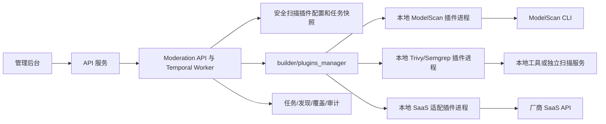

# 插件化资产安全扫描（EE）

状态：本地插件方案。来源：[代码安全扫描工作项 #3399](https://git-devops.opencsg.com/product/starhub/csghub-portal/-/work_items/3399) 及评论。安全扫描属于 EE 功能。

## 目标

- 对模型、代码、Skill、MCP 四类资产按不可变提交版本扫描可执行代码、模型文件和依赖清单，展示进度、发现项、覆盖范围与日志摘要；支持自动触发和管理员复扫。
- 风险通知、处置、豁免与复核保留审计；未覆盖、失败或无适用插件不能显示为“未发现风险”。
- 扫描工具可按客户需求安装、配置、启停和升级。接入新工具或 SaaS 时，只开发并安装适配器插件，不改 CSGHub 扫描工作流。

## 统一的本地插件架构

- **Moderation**统一对外提供扫描任务与查询服务。它选择已启用插件、保存任务所用包版本和配置快照、提交/轮询任务并聚合结果。插件进程由现有 `builder/plugins_manager` 启动与缓存，遵守现有 HashiCorp go-plugin 的本地进程模型；阿里云内容扫描仍由该管理器管理。安全扫描与内容合规扫描的业务协议不同，但共用进程生命周期机制。
- **适配器**是安装在插件目录中的本地可执行程序，通过版本化 gRPC 插件协议与 Moderation 通信。它自己选择运行 CLI、调用客户自部署扫描服务或远程 SaaS。Moderation 不需要知道第三方 API 形式，也不直接执行管理员输入的命令。本地命令由可信插件包固定，远程服务地址可作为插件声明的参数配置；密钥通过指定的服务环境变量引用，不写入数据库、任务或后台响应。
- **部署**可只安装客户需要的插件。Moderation API 实例和运行 Temporal Worker 的实例必须能访问同一套不可变插件包版本和对应环境变量；可用共享只读卷或一致的镜像层。插件进程在实际调用它的服务实例本地启动，扫描工具或 SaaS 可以在其他进程、容器或网络位置。新增或升级兼容协议的插件包后，管理员登记新版本并启用，无需改 CSGHub 代码；旧任务按其快照使用旧版本。不可覆盖正在被任务引用的同名版本文件。

## 安装与信任边界

- 管理员可以登记**运维预安装**的插件。服务端检查名称/版本、真实文件路径与 SHA-256，读取能力后才可启用。预安装包的发布、权限和来源由运维信任链保证。
- 管理后台可从服务端配置的 HTTPS 插件仓库下载指定名称/版本的包，并校验期望 SHA-256。下载包只写入由 `OPENCSG_SECURITY_SCAN_PLUGIN_STAGING_PATH` 指定的可写暂存区，与只读运行目录隔离。**本次仅保留验签接口及拒绝默认的空实现**：状态为 `pending` 的下载包不能探测、配置、启用或执行。后续服务端子任务实现可信发布者公钥、签名文件格式、签名/摘要/清单验证、密钥轮换、原子安装和审计后，才能把验证通过的包移入运行目录。SHA-256 只能证明传输完整性，不能替代发布者验签。
- 插件注册、下载、启停和检测接口只对平台管理员开放。插件包须受文件大小、路径、符号链接和重定向约束；生产运行应设进程权限、资源和出网限制。管理员只能配置已安装可信插件声明的参数，不能把任意 shell 命令交给服务执行。

## 插件接入契约

协议源位于 `plugins/protocol/securityscan/v1/security_scan_ee.proto`，适配器实现 `Capabilities`、`Submit`、`Poll`、`Cancel`。`Capabilities`声明协议版本、适用资产/格式/扫描类型；`Submit` 接收稳定任务 ID、提交 SHA 与获准文件清单并幂等返回任务 ID；`Poll` 返回状态、标准化发现项、逐文件覆盖状态和日志摘要；`Cancel` 尽力取消。插件内部将厂商结果映射到统一严重级别、规则、路径、行号和修复建议，不得把失败或部分覆盖当成通过。

当前 v1 使用**适配器拉取文件内容**：Moderation 发送绑定提交 SHA 的获准文件清单、短期 Bearer 令牌和 HTTPS 文件地址，插件仅按任务需要流式回拉并校验内容。模型 LFS 文件读取真实对象。现有候选文件筛选不等于整仓扫描，Trivy/Semgrep 等需整仓上下文的插件不得宣称已完成整仓覆盖。后续扩展完整提交快照下载；只有需要 Git 历史的扫描器才增加短期、单仓库、只读 Git/LFS 授权。SaaS 插件自行决定是否把回拉文件传给厂商。`OPENCSG_SECURITY_SCAN_FETCH_BASE_URL` 是插件可访问的 Moderation HTTPS 地址，`OPENCSG_SECURITY_SCAN_FETCH_SIGNING_KEY` 用于生成限时任务令牌。`OPENCSG_SECURITY_SCAN_PLUGIN_REGISTRY_URL` 是可选的服务端插件仓库地址；`OPENCSG_SECURITY_SCAN_PLUGIN_STAGING_PATH` 是下载暂存目录。

### 开发适配器

1. 实现 `plugins/securityscan/v1.Scanner`，用 `plugin.Serve` 注册 `securityscan.PluginName` 和 `HandshakeConfig`；使用仓库提供的协议代码生成脚本保持 gRPC 兼容。不要另开对 Moderation 的远程协议。
2. 声明真实能力和配置项；对配置参数和任务输入做校验。需要本地 CLI 的插件在自身代码中用固定命令模板启动工具；需要 SaaS 的插件在自身代码中调用服务 API。服务端只传非敏感配置与受控环境变量引用。
3. 按任务令牌从 Moderation 获取获准文件，限制文件数、大小、路径、超时和并发。结果必须包含每个分配文件的覆盖状态；失败、跳过和下载错误分别报告。任务 ID 重试要幂等，运行中支持轮询及尽力取消。
4. 构建带 `ee` 或 `saas` 标签的独立插件二进制，连同版本、SHA-256、能力、依赖工具和部署说明交付。运维预安装后可登记并启用；下载路径须等待真实验签完成。契约验证至少覆盖能力、重复提交、轮询、取消、恶意路径、部分覆盖和工具失败。

[本地 ModelScan 样例](../../plugins/securityscan/examples/README_ee.md) 用 go-plugin 进程调用 ModelScan CLI，仅声明 `.pkl` 文件。样例任务状态在内存中，不能作为生产级持久任务执行器。

## 服务端与前端

API 负责四类资产的管理员权限、手动复扫及扫描结果入口；Moderation 负责任务、能力匹配、提交、轮询、结果校验、通知与审计；数据库保存插件配置、包版本与摘要、任务快照、发现和覆盖。前端在资产详情展示扫描进度和风险结论，允许查看历史、发现、覆盖与处置；平台插件管理界面提供预安装插件登记/配置/检测/启停，以及下载包暂存与待验签状态。业务流程遵守 `handler -> component -> builder`。

## 后续阶段与验收

1. 完成统一本地插件协议、受信任预安装登记、任务快照和 ModelScan 样例，并验证 CE 构建不含 EE 实现。
2. 完成插件仓库下载后的真实验签、安全安装、密钥轮换和审计；在此之前下载件不可运行。
3. 分别交付 Trivy、Semgrep、SaaS 参考插件，完成完整提交快照或所需的 Git 授权扩展。
4. 完成管理后台的安装、配置、启停、状态界面和四类资产的扫描结果/处置界面。

验收包括四类资产、真实 LFS、无适用插件、部分失败、报告无效、重复事件、包升级时旧任务、旧提交晚完成、手动复扫、邮件去重与审计权限。
