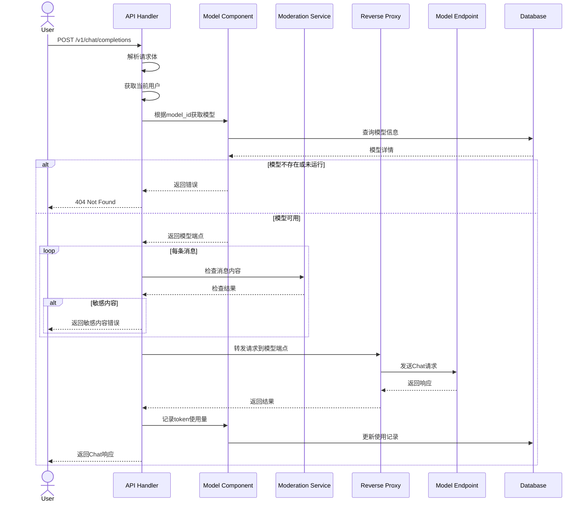

## 模型推理Chat接口流程



## Chat API 接口文档

### 接口定义

Endpoint:  
`POST /v1/chat/completions`

#### 请求头
| 参数名 | 类型 | 必填 | 描述 |
|--------|------|------|------|
| Authorization | string | 是 | Bearer token格式: `Bearer <access_token>` |
| Content-Type | string | 是 | 必须为`application/json` |

#### 请求体 (ChatCompletionRequest)
```json
{
  "model": "string",
  "messages": [
    {
      "role": "string",
      "content": "string"
    }
  ],
  "temperature": number,
  "top_p": number,
  "n": integer,
  "stream": boolean,
  "stop": ["string"],
  "max_tokens": integer,
  "presence_penalty": number,
  "frequency_penalty": number,
  "logit_bias": object
}
```

#### 响应参数 (ChatCompletionResponse)
```json
{
  "id": "string",
  "object": "string",
  "created": integer,
  "model": "string",
  "choices": [
    {
      "index": integer,
      "message": {
        "role": "string",
        "content": "string"
      },
      "finish_reason": "string"
    }
  ],
  "usage": {
    "prompt_tokens": integer,
    "completion_tokens": integer,
    "total_tokens": integer
  }
}
```

### 调用示例

```bash
curl -X POST "https://api.example.com/v1/chat/completions" \
  -H "Authorization: Bearer your_access_token" \
  -H "Content-Type: application/json" \
  -d '{
    "model": "gpt-3.5-turbo",
    "messages": [
      {
        "role": "user",
        "content": "Hello!"
      }
    ],
    "temperature": 0.7,
    "max_tokens": 100
  }'
```

### 响应示例

成功响应 (200):
```json
{
  "id": "chatcmpl-123",
  "object": "chat.completion",
  "created": 1677652288,
  "model": "gpt-3.5-turbo",
  "choices": [{
    "index": 0,
    "message": {
      "role": "assistant",
      "content": "Hello there! How can I help you today?"
    },
    "finish_reason": "stop"
  }],
  "usage": {
    "prompt_tokens": 9,
    "completion_tokens": 12,
    "total_tokens": 21
  }
}
```

错误响应 (400):
```json
{
  "error": "invalid_request_error",
  "message": "The model does not exist"
}
```