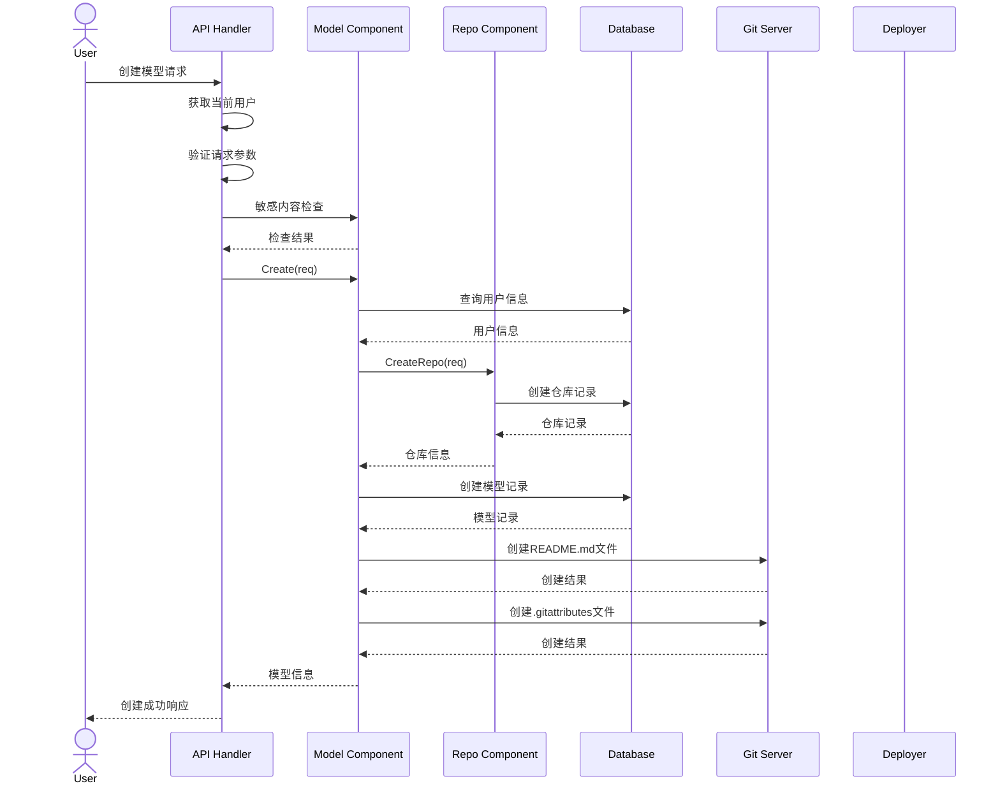

# 创建模型API



## 接口定义

Endpoint:  
`POST /api/v1/models`

### 请求头
| 参数名 | 类型 | 必填 | 描述 |
|--------|------|------|------|
| Authorization | string | 是 | Bearer token格式: `Bearer <access_token>` |
| Content-Type | string | 是 | 必须为`application/json` |

### 请求参数
```json
{
  "name": "string",
  "namespace": "string",
  "description": "string",
  "license": "string",
  "base_model": "string",
  "private": boolean,
  "default_branch": "string",
  "readme": "string",
  "nickname": "string"
}
```

字段说明：
- `name`: 模型名称 (必填)
- `namespace`: 命名空间/用户名 (必填)  
- `description`: 模型描述
- `license`: 许可证类型
- `base_model`: 基础模型名称
- `private`: 是否私有
- `default_branch`: 默认分支名
- `readme`: README内容
- `nickname`: 模型昵称

### 响应参数
成功响应 (200):
```json
{
  "id": "string",
  "name": "string",
  "path": "string",
  "namespace": "string",
  "description": "string",
  "created_at": "string",
  "updated_at": "string",
  "private": boolean,
  "default_branch": "string"
}
```

错误响应 (400):
```json
{
  "error": "string",
  "message": "string"
}
```

## 调用示例

```bash
curl -X POST "https://api.example.com/api/v1/models" \
  -H "Authorization: Bearer your_access_token" \
  -H "Content-Type: application/json" \
  -d '{
    "name": "my-llm-model",
    "namespace": "user123",
    "description": "My first language model",
    "license": "apache-2.0",
    "base_model": "llama-2",
    "private": false,
    "default_branch": "main",
    "readme": "# My Model\nThis is my first model",
    "nickname": "My LLM"
  }'
```

成功响应示例:
```json
{
  "id": "model_123",
  "name": "my-llm-model",
  "path": "user123/my-llm-model",
  "namespace": "user123",
  "description": "My first language model",
  "created_at": "2025-04-19T13:17:22Z",
  "updated_at": "2025-04-19T13:17:22Z",
  "private": false,
  "default_branch": "main"
}
```