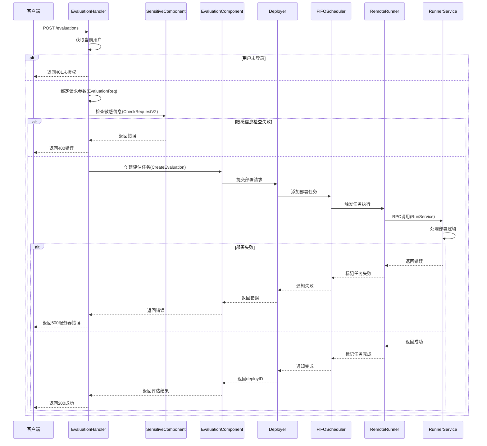

# 评估任务完整调用流程时序图



# FinetuneCreate 接口文档

## 接口说明
创建微调实例

## 请求方法
POST

## 请求路径
/models/{namespace}/{name}/finetune

## 请求参数

### Path 参数
| 参数名 | 类型 | 必填 | 描述 |
|-------|------|------|------|
| namespace | string | 是 | 命名空间 |
| name | string | 是 | 模型名称 |

### Query 参数
| 参数名 | 类型 | 必填 | 描述 |
|-------|------|------|------|
| current_user | string | 是 | 当前用户 |

### Body 参数 (application/json)
```json
{
  "deploy_name": "string",
  "cluster_id": "string",
  "resource_id": 0,
  "runtime_framework_id": 0,
  "revision": "string",
  "order_detail_id": 0,
  "engine_args": "string"
}
```

字段说明：
- deploy_name: 部署名称
- cluster_id: 集群ID
- resource_id: 资源ID
- runtime_framework_id: 运行时框架ID
- revision: 版本/分支
- order_detail_id: 订单详情ID
- engine_args: 引擎参数

## 响应

### 成功响应 (200)
```json
{
  "deploy_id": 0
}
```

### 错误响应
- 400: 请求参数错误
- 401: 未授权
- 403: 禁止访问
- 500: 服务器内部错误