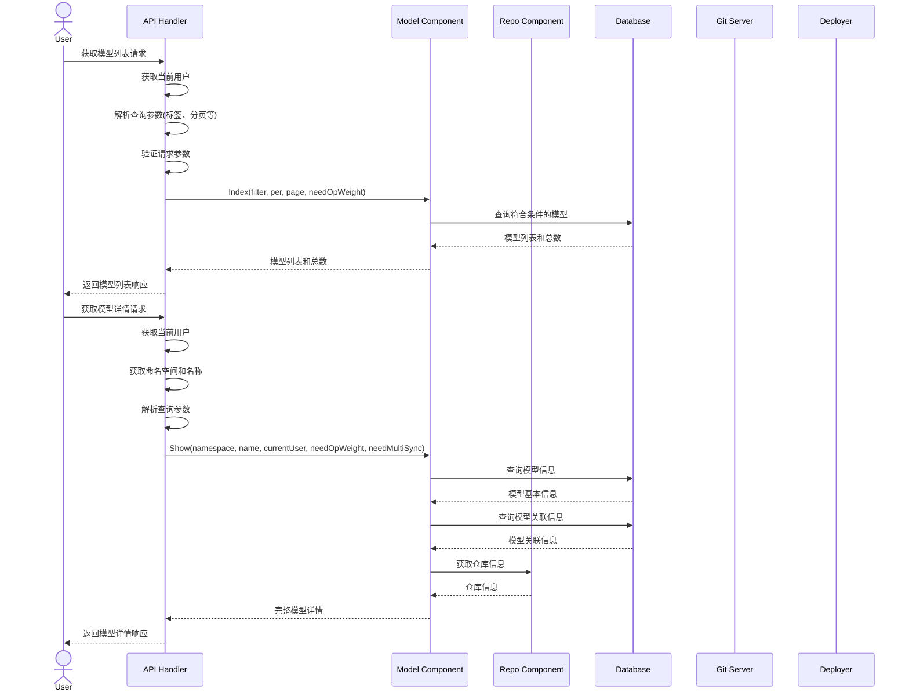

# 查询模型流程



## 获取单个模型详情API

### 接口定义

Endpoint:  
`GET /api/v1/models/{namespace}/{name}`

#### 请求头
| 参数名 | 类型 | 必填 | 描述 |
|--------|------|------|------|
| Authorization | string | 是 | Bearer token格式: `Bearer <access_token>` |

#### 查询参数
| 参数名 | 类型 | 必填 | 描述 |
|--------|------|------|------|
| need_op_weight | boolean | 否 | 是否需要操作权重，默认false |
| need_multi_sync | boolean | 否 | 是否需要多端同步信息，默认false |

#### 路径参数
| 参数名 | 类型 | 必填 | 描述 |
|--------|------|------|------|
| namespace | string | 是 | 模型所属命名空间 |
| name | string | 是 | 模型名称 |

### 响应参数
成功响应 (200):
```json
{
  "id": "string",
  "name": "string",
  "namespace": "string",
  "description": "string",
  "license": "string",
  "private": boolean,
  "created_at": "string",
  "updated_at": "string",
  "default_branch": "string",
  "tags": [
    {
      "name": "string",
      "category": "string"
    }
  ],
  "repo_info": {
    "id": "string",
    "name": "string",
    "path": "string"
  },
  "related_models": [
    {
      "id": "string",
      "name": "string",
      "namespace": "string"
    }
  ]
}
```

错误响应 (404):
```json
{
  "error": "string",
  "message": "string"
}
```

### 调用示例

```bash
curl -X GET "https://api.example.com/api/v1/models/user123/my-llm-model" \
  -H "Authorization: Bearer your_access_token" \
  -H "Content-Type: application/json"
```

成功响应示例:
```json
{
  "id": "model_123",
  "name": "my-llm-model",
  "namespace": "user123",
  "description": "My first language model",
  "license": "apache-2.0",
  "private": false,
  "created_at": "2025-04-19T13:17:22Z",
  "updated_at": "2025-04-19T13:17:22Z",
  "default_branch": "main",
  "tags": [
    {
      "name": "llama",
      "category": "base_model"
    }
  ],
  "repo_info": {
    "id": "repo_456",
    "name": "my-llm-model",
    "path": "user123/my-llm-model"
  },
  "related_models": [
    {
      "id": "model_789",
      "name": "base-llama",
      "namespace": "meta"
    }
  ]
}
```