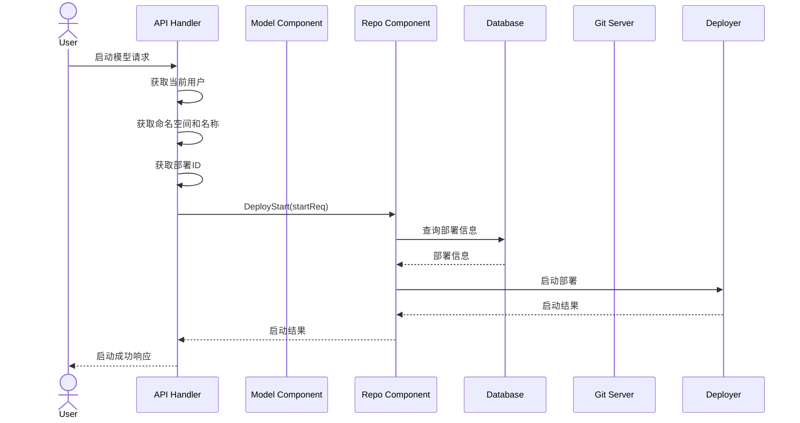

# 启动模型流程



## 启动模型API

### 接口定义

Endpoint:  
`PUT /api/v1/models/{namespace}/{name}/run/{id}/start`

#### 请求头
| 参数名 | 类型 | 必填 | 描述 |
|--------|------|------|------|
| Authorization | string | 是 | Bearer token格式: `Bearer <access_token>` |

#### 路径参数
| 参数名 | 类型 | 必填 | 描述 |
|--------|------|------|------|
| namespace | string | 是 | 模型所属命名空间 |
| name | string | 是 | 模型名称 |
| id | int | 是 | 部署ID |

### 响应参数
成功响应 (200):
```json
{
  "success": true,
  "message": "启动成功"
}
```

错误响应 (400):
```json
{
  "error": "string",
  "message": "string"
}
```

### 调用示例

```bash
curl -X PUT "https://api.example.com/api/v1/models/user123/my-llm-model/run/123/start" \
  -H "Authorization: Bearer your_access_token" \
  -H "Content-Type: application/json"
```

成功响应示例:
```json
{
  "success": true,
  "message": "模型部署已成功启动"
}
```