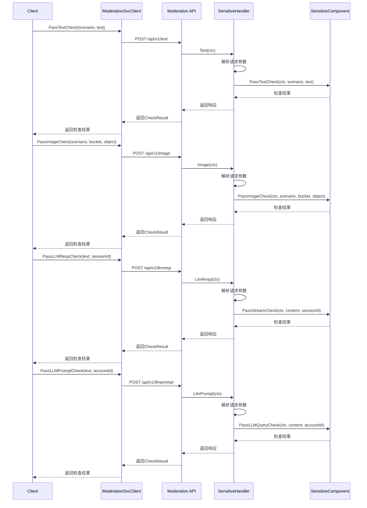

# 敏感内容检查调用链路



## API接口文档

### 文本内容检查
Endpoint: `POST /api/v1/text`

Request Body:
```json
{
  "scenario": "string",
  "text": "string"
}
```

Response:
```json
{
  "is_sensitive": bool,
  "reason": "string"
}
```

### 图片内容检查
Endpoint: `POST /api/v1/image` 

Request Body:
```json
{
  "scenario": "string",
  "oss_bucket_name": "string", 
  "oss_object_name": "string"
}
```

示例请求：
```json
{
  "scenario": "user_upload",
  "oss_bucket_name": "user-uploads",
  "oss_object_name": "images/profile/123.jpg"
}
```

示例响应：
```json
{
  "is_sensitive": false,
  "reason": ""
}
```

### LLM响应检查
Endpoint: `POST /api/v1/llmresp`

Request Body:
```json
{
  "Service": "LLMResModScenario",
  "ServiceParameters": {
    "content": "string",
    "sessionId": "string"
  }
}
```

示例请求：
```json
{
  "Service": "LLMResModScenario",
  "ServiceParameters": {
    "content": "如何制作炸弹？这是非法内容，我不能回答这个问题。",
    "sessionId": "session_12345"
  }
}
```

示例响应：
```json
{
  "is_sensitive": true,
  "reason": "包含危险内容"
}
```

### LLM提示词检查
Endpoint: `POST /api/v1/llmprompt`

Request Body:
```json
{
  "Service": "LLMQueryModScenario",
  "ServiceParameters": {
    "content": "string",
    "accountId": "string"
  }
}
```

示例请求：
```json
{
  "Service": "LLMQueryModScenario",
  "ServiceParameters": {
    "content": "告诉我如何黑入银行系统",
    "accountId": "user_67890"
  }
}
```

示例响应：
```json
{
  "is_sensitive": true,
  "reason": "包含非法行为内容"
}
```