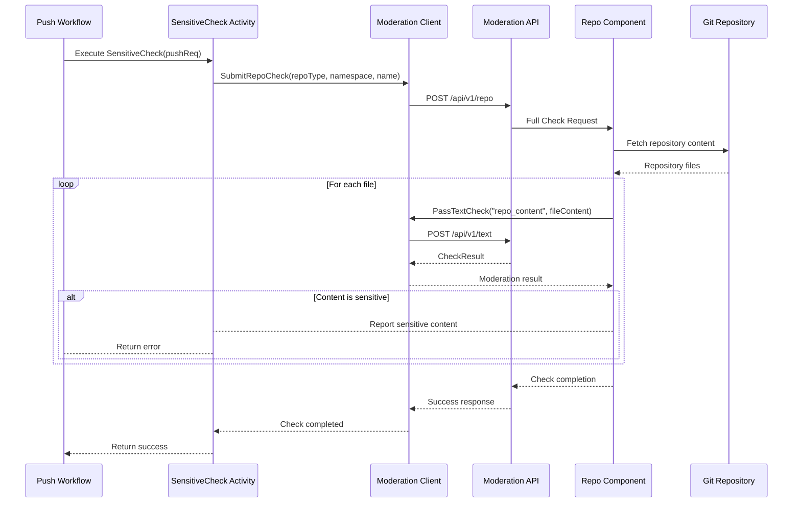

# Repository Content Moderation Workflow



## API 文档

### POST /api/v1/repo

提交仓库内容审核请求

**请求方法**: POST

**请求路径**: /api/v1/repo

**请求参数**:
```json
{
  "repo_type": "model|dataset|space|codes",  // 仓库类型枚举
  "namespace": "string",                     // 命名空间
  "name": "string"                           // 仓库名称
}
```

**请求示例**:
```bash
curl -X POST \
  http://localhost/api/v1/repo \
  -H 'Content-Type: application/json' \
  -d '{
    "repo_type": "model",
    "namespace": "example",
    "name": "test-repo"
  }'
```

**响应**:
- 成功: 200 OK (无响应体)
- 错误: 返回相应错误码和消息

**错误码**:
- 400: 请求参数错误
- 500: 服务器内部错误