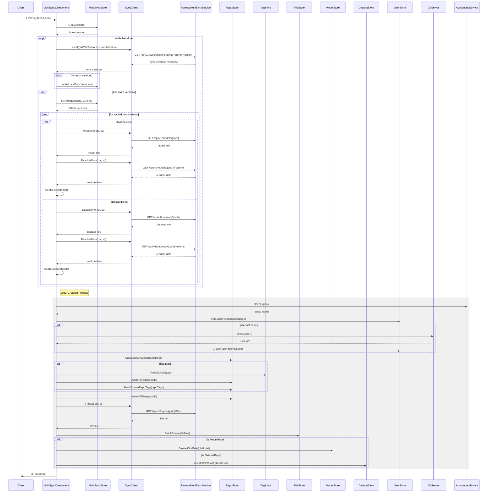

## API 文档: /api/v1/sync/versions

### 接口描述
获取自指定版本以来的同步版本信息

### 请求方法
GET

### 请求路径
`/api/v1/sync/versions`

### 请求参数
| 参数名 | 类型 | 必填 | 描述 |
|-------|------|------|------|
| cur | string | 是 | 当前版本号 |
| current_user | string | 是 | 当前用户标识 |

### 响应格式
```json
{
  "code": 0,
  "message": "success",
  "data": {
    "versions": [
      {
        "version": 0,
        "source_id": 0,
        "repo_path": "string",
        "repo_type": "string",
        "last_modify_time": "string",
        "change_log": "string"
      }
    ],
    "has_more": true
  }
}
```

### 字段说明
- `versions`: 版本变更列表
  - `version`: 版本号 (int64)
  - `source_id`: 数据源ID (0: opencsg, 1: HF)
  - `repo_path`: 仓库路径
  - `repo_type`: 仓库类型
  - `last_modify_time`: 最后修改时间
  - `change_log`: 变更日志
- `has_more`: 是否还有更多数据

### 错误码
| 错误码 | 描述 |
|-------|------|
| 400 | 无效的请求参数 |
| 401 | 未授权访问 |
| 500 | 服务器内部错误 |