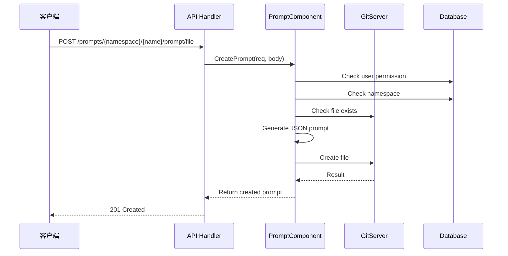
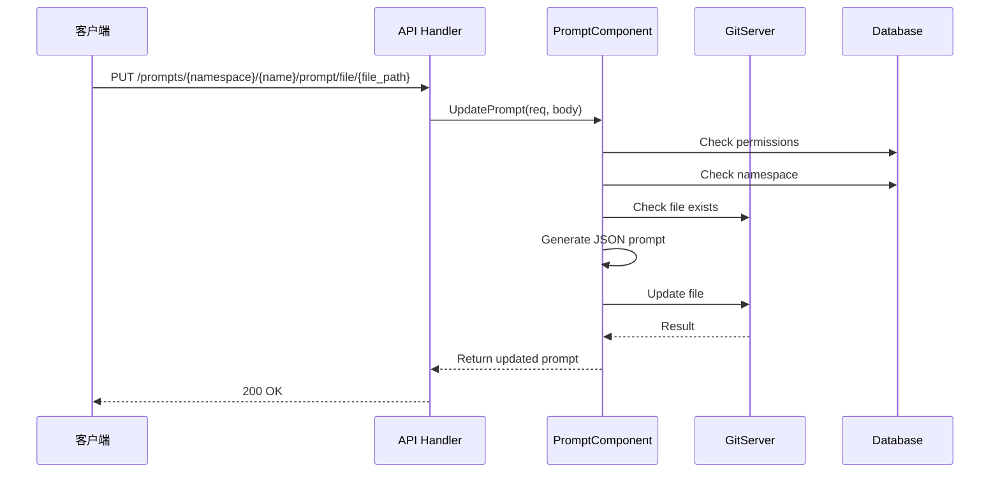
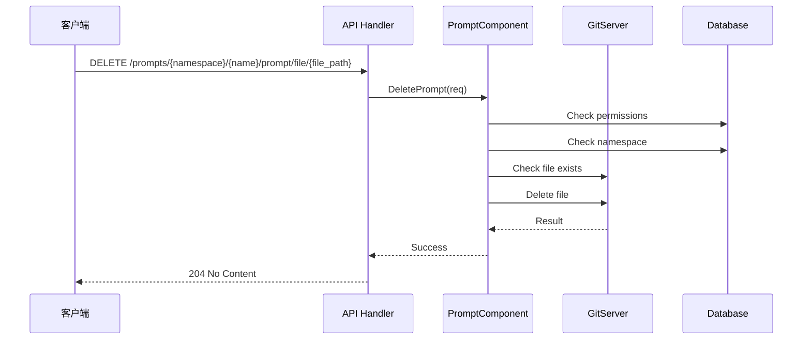
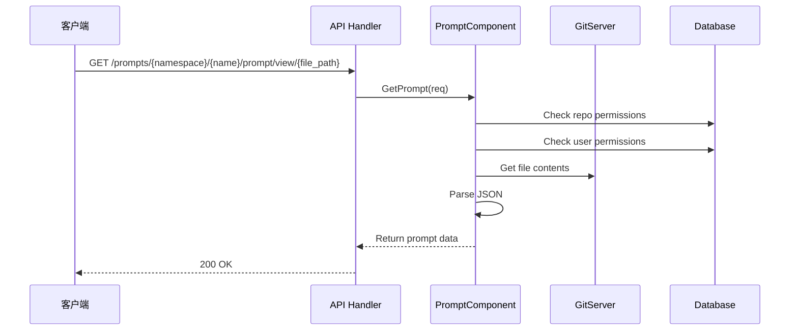

# Prompt API 调用时序图
创建时间: 2025-04-19

## 创建提示词时序图


---

## 更新提示词时序图


---

## 删除提示词时序图


---

## 获取提示词时序图


## REST API 接口文档

### 1. 创建提示词文件
**Endpoint**: POST `/prompts/{namespace}/{name}/prompt/file`

**请求参数**:
- Path:
  - `namespace`: 命名空间名称
  - `name`: 仓库名称
- Query:
  - `current_user`: 当前用户名(可选)
- Body:
  ```json
  {
    "content": "string",  // 提示词内容
    "file_path": "string" // 文件相对路径
  }
  ```

**响应**:
- 201 Created
  ```json
  {
    "msg": "success",
    "data": {
      "file_path": "string",
      "content": "string"
    }
  }
  ```

### 2. 更新提示词文件
**Endpoint**: PUT `/prompts/{namespace}/{name}/prompt/file/{file_path}`

**请求参数**:
- Path:
  - `namespace`: 命名空间名称
  - `name`: 仓库名称 
  - `file_path`: 文件相对路径
- Query:
  - `current_user`: 当前用户名(可选)
- Body:
  ```json
  {
    "content": "string"  // 新的提示词内容
  }
  ```

**响应**:
- 200 OK
  ```json
  {
    "msg": "success",
    "data": {
      "file_path": "string",
      "content": "string"
    }
  }
  ```

### 3. 删除提示词文件
**Endpoint**: DELETE `/prompts/{namespace}/{name}/prompt/file/{file_path}`

**请求参数**:
- Path:
  - `namespace`: 命名空间名称
  - `name`: 仓库名称
  - `file_path`: 文件相对路径
- Query:
  - `current_user`: 当前用户名(可选)

**响应**:
- 204 No Content (无返回体)

### 4. 获取提示词文件内容
**Endpoint**: GET `/prompts/{namespace}/{name}/prompt/view/{file_path}`

**请求参数**:
- Path:
  - `namespace`: 命名空间名称
  - `name`: 仓库名称
  - `file_path`: 文件相对路径
- Query:
  - `current_user`: 当前用户名(可选)

**响应**:
- 200 OK
  ```json
  {
    "msg": "success",
    "data": {
      "file_path": "string",
      "content": "string",
      "metadata": {
        "created_at": "timestamp",
        "updated_at": "timestamp"
      }
    }
  }
  ```