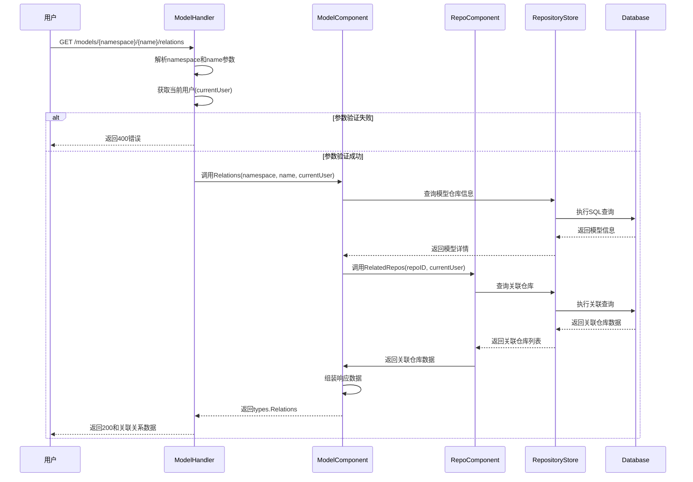

### API 文档

#### 获取模型关联关系
`GET /models/{namespace}/{name}/relations`

**请求参数**:
- Path参数:
  - namespace: 模型所属命名空间 (必填)
  - name: 模型名称 (必填)
- Query参数:
  - current_user: 当前用户(可选)

**响应示例**:
```json
{
  "data": {
    "datasets": [
      {
        "name": "example-dataset",
        "namespace": "example-org",
        "path": "example-org/example-dataset",
        "description": "示例数据集",
        "updated_at": "2023-01-01T00:00:00Z",
        "private": false,
        "downloads": 100
      }
    ],
    "codes": [
      {
        "name": "example-code",
        "namespace": "example-org",
        "path": "example-org/example-code",
        "description": "示例代码库",
        "updated_at": "2023-01-01T00:00:00Z",
        "private": false,
        "downloads": 50
      }
    ],
    "spaces": [
      {
        "name": "example-space",
        "namespace": "example-org",
        "path": "example-org/example-space",
        "description": "示例空间",
        "updated_at": "2023-01-01T00:00:00Z",
        "private": false
      }
    ],
    "prompts": [
      {
        "name": "example-prompt",
        "namespace": "example-org",
        "path": "example-org/example-prompt",
        "description": "示例提示词",
        "updated_at": "2023-01-01T00:00:00Z",
        "private": false,
        "downloads": 20
      }
    ]
  }
}
```

**错误响应**:
```json
{
  "error": {
    "code": "not_found",
    "message": "模型不存在"
  }
}
```

**主要流程**:
1. 验证请求参数(namespace,name)
2. 获取当前用户信息
3. 查询模型基本信息
4. 通过RepoComponent查询关联的仓库(数据集、代码、空间、提示词等)
5. 组装响应数据并返回